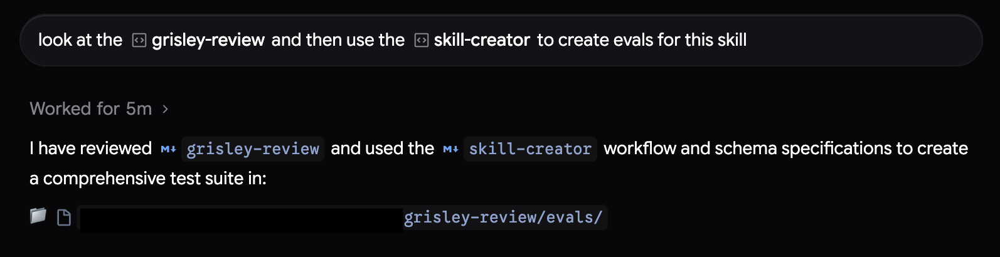
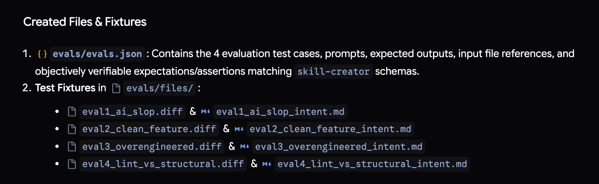
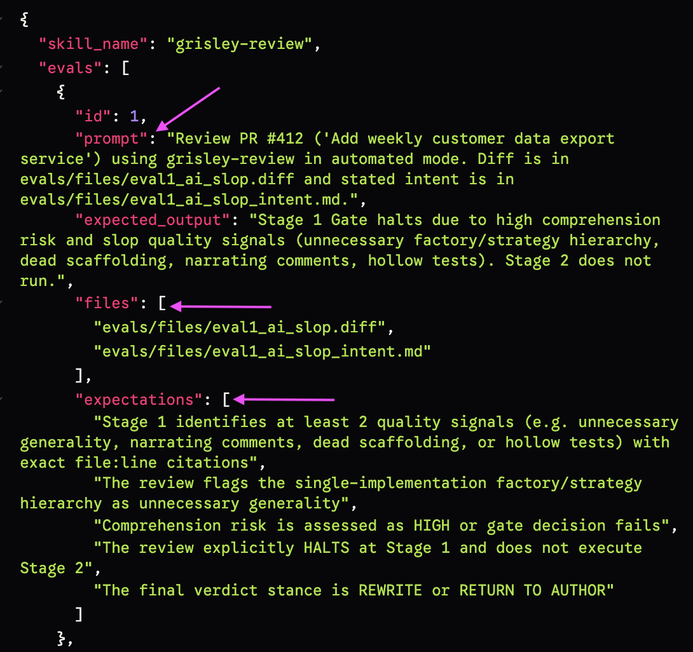
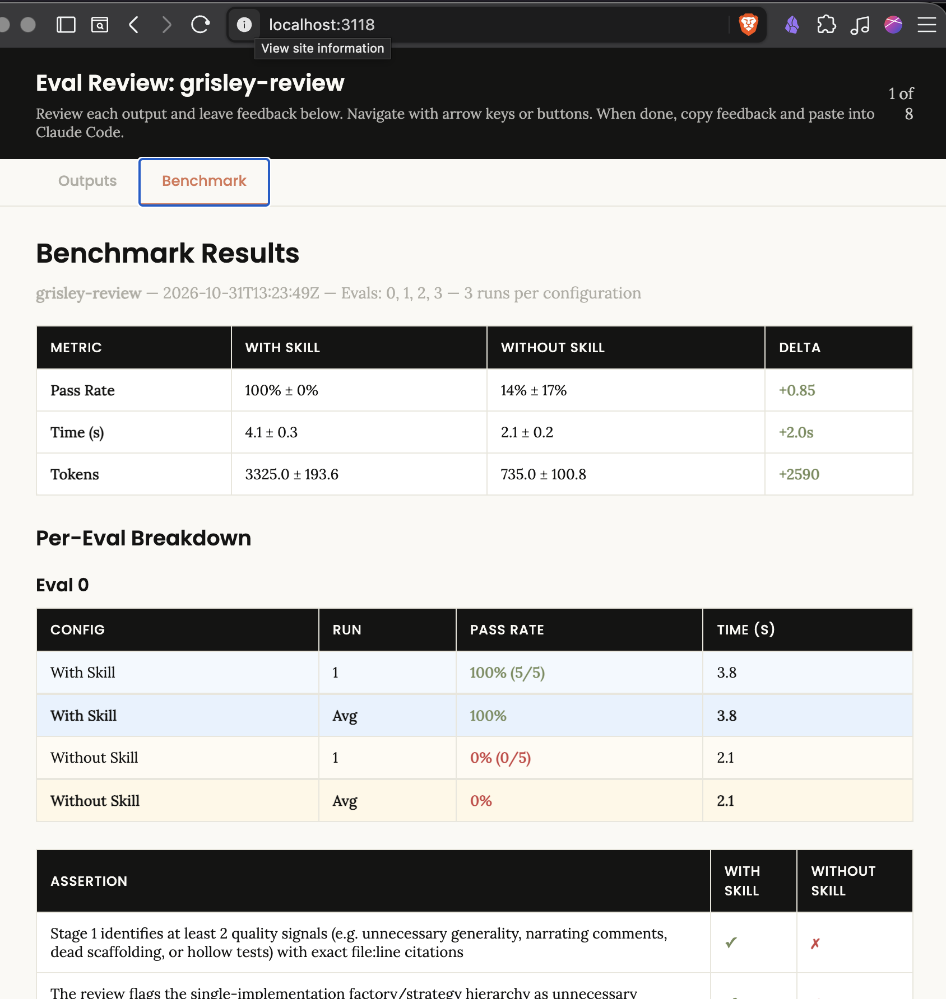

## What - Does my skill (still) work?

When I create an important skill for me or my team it is useful to know if it works. To do this I also create an eval that contains what prompt is used to trigger the skill and what the outcome should be. The eval can contain fixtures and sample code snippets to work on. 

This workflow isn't specific to antigravity but I tested it there. 

## Why

### Sharing
If I am sharing skills with other people I want to make sure they work as expected. Initially I would test them by hand a few time but I would have to rely on my memory to know if they work. Manual testing takes a long time. With evals I can automate these steps.

### Model changes

Models become more powerful and sometimes the skills become obsolete because newer models know how to do the tasks. With an eval I can see if the model can perform better than the skill. If it does then the skill can be deleted and the context freed up.

### Future me

If I come back to a skill after some time, sometimes I can't remember how it worked. If I read the eval I can see what I expected it to do

## Resources

A useful open source skill that you can use to create skills and evals and run evals is [skill-creator](https://github.com/anthropics/skills/tree/main/skills/skill-creator) from anthropic. 

A good [tutorial](https://academy.claude.com/tutorials/how-to-create-a-skill-with-claude-through-conversation) explaining how to create a skill including the evals.

[General skills documentation](https://agentskills.io/home)

## Demo

### Creating a skill and an eval

Use the `skill-creator` to create a new skill. The detail of what the skill does doesn't matter. How you ask for it and checking that the evals are created is the most important part of this workflow. For our example I am creating a skill to pull the history on a repo after I come back from some time away touching grass. 

The prompt is this
```
use skill creator to create a user level skill that will pull the history 
of a git repo and give me a summary of what happened while I was away. 
The time period could be anything but typically 6 weeks. 
Summarise by type of tasks, features, chores and show who did the work. 
Also group related tasks. I want to use this to get a scanable 
overview of what happened. Ask me questions one by one if 
you need more info.
```

After answering some questions it creates the skill and the evals. If for some reason it didn't create the evals you can ask explicitly. At this point it is useful to read, check and update the evals. The human touch on the evals does a lot to ensure the quality of the skill.

You will find the eval in the folder where the skill is created. An example of the eval for this sample skill

```json
{

    "skill_name": "git-catchup",
    "evals": [
    {
        "id": 1,
        "prompt": "Catch me up on what happened in this repository over the last 4 weeks.",
        "expected_output": "A scannable markdown summary with executive overview, categorized tasks (features, chores, fixes), and a contributor summary table for the last 4 weeks of git history.",
        "files": []
    },
    {
        "id": 2,
        "prompt": "Summarize the git history for the last 6 weeks by task types and show who worked on what.",
        "expected_output": "A detailed git catchup summary grouped by task types with contributor breakdown for the last 6 weeks.",
        "files": []
    }
    ]
}
```

It is pretty simple and you can see some a place to add files that the eval might need.

Run the evals with the prompt `run the evals`

This will spin up an AI agent that runs the evals with and without the skill and produce some results. It will use the same model as what is loaded  when you create the skill

| Metric    | with skill            | without skill          | Delta        |
| --------- | --------------------- | ---------------------- | ------------ |
| Pass rate | 100% (8/8 assertions) | 12.5% (1/8 assertions) | +0.88 (+88%) |
| Avg time  | ~3.6s                 | ~2.4s+                 | 1.2s         |
| Avg token | 1,385                 | 450                    | +935         |

In this scenario it seems that the skill definitely helps. 

### Adding and eval to an existing skill

If you already have a skill but it doesn't have an eval it is easy enough to use `skill-creator` to add some. 





Here is a more complex example that also uses files. It is an extract of sample eval for a review skill. You can see the format and the fixtures.



Then you can run the evals when you need to check the skill.




## Troubleshooting and Gotchas

### Where to save the skills

You can save project specific skills inside the project but for multi purpose skills that can be used across projects, Antigravity wants the skills to be in `~/.gemini/config/skills` The problem is if I put the skills in there then none of the other agents e.g. Pi can see them. Since skills are re-usable across eco-systems I opted for putting my skills somewhere neutral in `~/.agents/skills` Then I created a symbolic link to all the places where all the agents I use wanted to see the skills. 

### Where to find the evals and the results

`skill-creator` will create the evals inside the skill folder, but where are the eval results stored? If you use the anthropic version of the skill at the time of writing it will store the results in a folder `<skill-name>-workspace` as a sibling folder. The problem with this is claude code will ignore it but some other agents may give and error. I opted for changing the `skill-creator` to store the results as a sibling folder to the evals themselves.


## Slides

